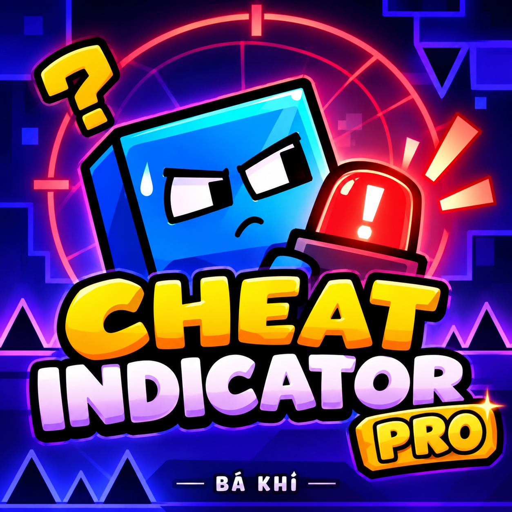

# Cheat Indicator Pro 🚨

The most badass(Bá Khí) cheat indicator mod in Vietnam.

> "I swear I wasn't cheating, my game was just lagging." 
> — every person this mod has ever turned red

## What does it do?

It watches you play and judges you silently. If something looks fishy, the dot turns **red**.

- **Speed and physics scan:** if your speed and physics don't agree with each other, someone is lying. Usually it's not the mod.
- **Click scan:** clicking like a robot? The mod notices. Humans are not that consistent.
- **Mod scan:** checks your installed mods and gives them the "are you sure about that?" look.
- **Run reports:** saves a report when you beat a level, so the evidence is ready for court.

## Disclaimer

This mod gives warnings, not verdicts. A red dot can also be caused by lag or unstable FPS, so please don't start a war in the comments. 

## Install

Grab the `.geode` file from the latest build in the Actions tab and drop it in your Geode `mods` folder. Easy.

## Build
